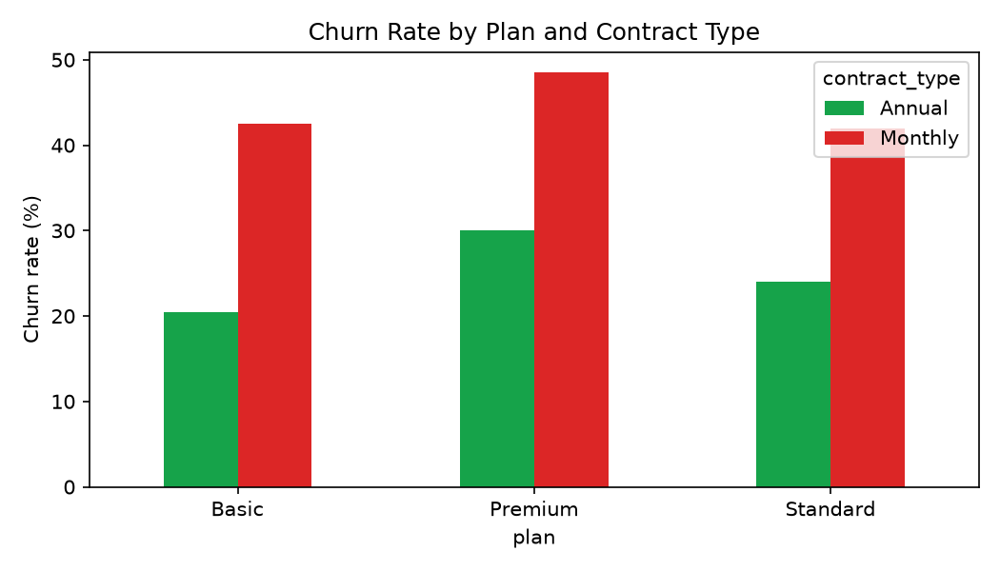
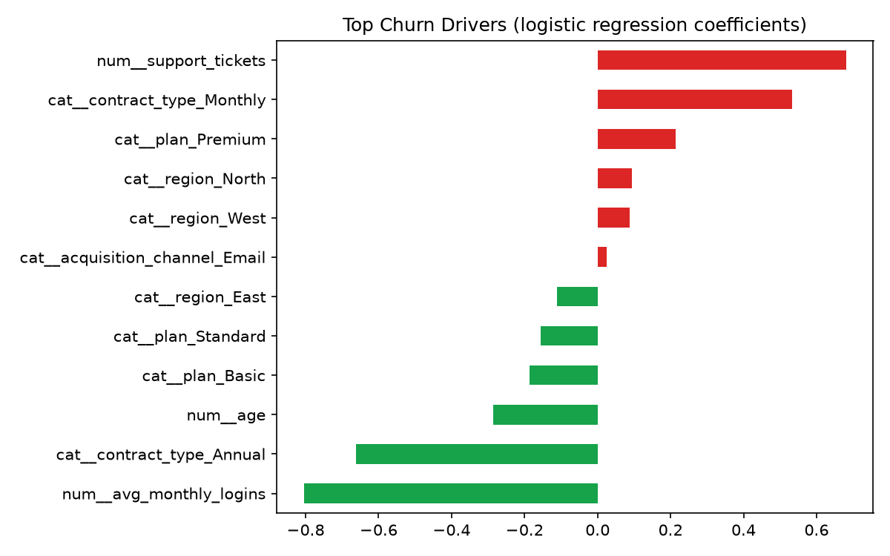
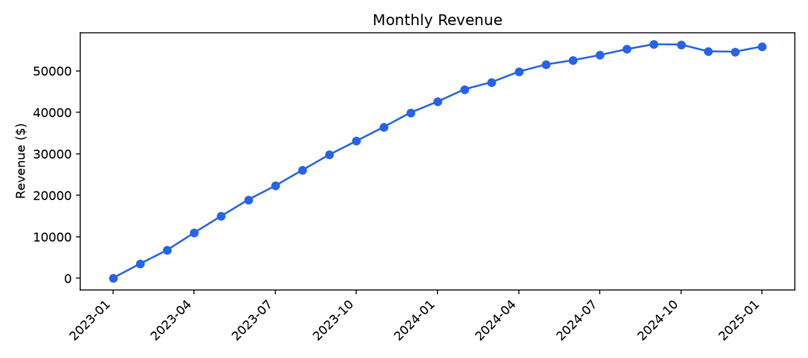

# Customer Churn Analytics Pipeline

An end-to-end data project for a subscription business: **raw messy data → ETL → SQL warehouse → analysis → machine-learning model**. It covers the core workflow of three roles in one repo:

| Role | What this repo shows |
|---|---|
| **Data Analyst** | SQL (CTEs, window functions, cohort retention), KPI analysis, charts |
| **Data Engineer** | Reproducible ETL, data cleaning & validation, SQLite warehouse, unit tests |
| **AI/ML Engineer** | Feature pipeline, model comparison with cross-validation, saved model, inference script |

## Business problem

A subscription company is losing customers. Which customers churn, why, and can we predict it early enough to act?

## Pipeline

```
generate_data.py → etl.py → warehouse.db (SQLite) → analysis.py (SQL + charts)
                                                  → train_model.py → churn_model.joblib → predict.py
```

1. **Generate** (`src/generate_data.py`): creates ~5,000 customers and ~50k billing records with realistic problems injected on purpose (duplicates, nulls, invalid ages, inconsistent casing).
2. **ETL** (`src/etl.py`): removes duplicates, standardises text, imputes invalid values, drops orphan records, runs data-quality assertions, loads to SQLite.
3. **Analysis** (`sql/analysis.sql`, `src/analysis.py`): seven SQL queries exported to `reports/` as CSV plus charts.
4. **Modelling** (`src/train_model.py`): logistic regression vs. gradient boosting in a scikit-learn `Pipeline`, 5-fold CV, ROC-AUC, confusion matrix, saved model.
5. **Inference** (`src/predict.py`): scores a single customer.

## Key findings

- Overall churn is **~37%**.
- **Monthly-contract customers churn about twice as much** as annual ones (e.g. Basic: 42.5% vs 20.5%).
- Churn climbs steeply with support tickets: **22% with 0 tickets → 80% with 5+**.
- Premium monthly customers are the highest-risk segment (48.5%).
- The best model (logistic regression) reaches **ROC-AUC ≈ 0.78** with ~70% recall on churners; gradient boosting performed about the same, so the simpler, more interpretable model was kept.





## Run it

```bash
git clone <your-repo-url> && cd churn-analytics-pipeline
python -m venv .venv && source .venv/bin/activate   # Windows: .venv\Scripts\activate
pip install -r requirements.txt

make all        # generate data, run ETL, run analysis, train model
make test       # unit tests
python -m src.predict
```

No `make`? Run the four commands in the Makefile one after another.

## Project structure

```
├── data/raw/            generated CSVs (git-ignored)
├── data/processed/      SQLite warehouse (git-ignored)
├── sql/analysis.sql     all analysis queries
├── src/                 generate_data, etl, analysis, train_model, predict, config
├── tests/               pytest unit tests for the ETL logic
├── reports/             query outputs, metrics, figures
└── models/              saved model (git-ignored)
```

## Limitations and next steps

- The data is synthetic, so the findings illustrate the method, not a real company. Swap in a real dataset (e.g. Telco Customer Churn on Kaggle) by changing `generate_data.py`.
- Possible extensions: migrate SQLite to PostgreSQL, schedule the pipeline with Airflow, add a Streamlit dashboard, track experiments with MLflow, containerise with Docker.
